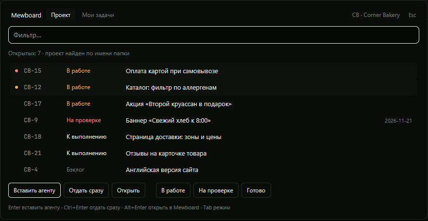

# Mewboard

A popup with the open Mewboard tasks of the project you are working in, or all of
yours, that hands the chosen task to the agent of the space (Claude Code, Codex…)
in one key: pasted into the agent's input, or sent right away.

## What you see

A popup 880 px wide and 75% of the window high, 40 px from the top, on the theme's
popover color with 16 px padding and 10 px gaps:

- A header row: "Mewboard" (600 weight), two tabs "Проект" / "Мои задачи"
  ("Project" / "My tasks"; the selected one on the hover color), and at the right
  the folder's project as `KEY · Name` (dim, clickable) and "Esc".
- A 36 px filter input with an accent border on the background color
  (placeholder "Фильтр…").
- A status line in 12 px dim text: the number of open tasks, and "project found
  by folder name" when the match came from the name; errors in the blocked color.
- The list, 34 px rows, at most 470 px tall then scrolling: a 6 px priority dot
  (urgent in the blocked color, high in the working color), the key in JetBrains
  Mono 12 px, the status (its icon and name; in progress in the working color, in
  review in the blocked color, to do in the foreground, backlog dim), the title
  truncated, and on "My tasks" the project key, and the due date when set. The
  selected row has the hover color.
- Buttons under the list: "Вставить агенту" (accent border), "Отдать сразу",
  "Открыть", then "В работе", "На проверке", "Готово".
- A hint line in 11 px dim text with the keys.

All words follow `shared("ui.lang")`: English when it is "en", Russian otherwise.
A folder with no project shows the project list instead (key and name per row),
with "Which project is "folder"? The choice is remembered for this folder."

## How it behaves

- Ctrl+Shift+M (Cmd+Shift+M on macOS) toggles the popup. Typing filters (every
  word must appear in key, title, status or project). Up/Down move, Tab switches
  "Project" / "My tasks", Esc closes. Clicking a row selects it.
- Enter pastes the task into the agent's input without sending it: "Задача KEY-12:
  title", the description (at most 4000 characters) and the task's Mewboard link.
  The popup puts the text on Herdr's clipboard, focuses the agent, runs
  `terminal.paste`, puts the old clipboard text back 0.7 s later and closes.
- Cmd/Ctrl+Enter sends the same text now with `hc send` (paste and Enter), then
  closes with a toast "Отдано агенту". Alt+Enter opens the task in the browser.
- The status buttons set the task to in progress, in review or done, show a
  toast, and reload the list.
- Which agent: the focused terminal if it is an agent, else the one ProdAdvice
  remembers for the space (`shared("files.agents")`), else the space's only
  agent. Several agents and no choice: a toast asks to click the right one. No
  agent: a toast says so and nothing is pasted, because a plain shell would run
  the task's lines as commands.
- Which project: a choice saved for the folder, else a project whose key or name
  matches the folder name, or whose name starts the folder name or the other way
  round, counted once with its sub-projects, when exactly one fits. Otherwise the
  project list; picking one saves it. Clicking the project name changes it.
- The list reloads every 30 s while the popup is open.

## Built from

- One mod, `mods/mewboard`, opened as an overlay: `mod.json` is
  `{ "place": "none", "title": "Mewboard", "overlay": { "kind": "popup", "at": "top", "offset": 40, "width": 880, "height": 0.75 } }`.
  `keys.json` binds `ctrl-shift-m` (Windows, Linux) and `keys.macos.json`
  `cmd-shift-m` to `mod.open:mewboard`, in the global section.
- `model.js` has no Herdr imports: project matching, sorting (status kind in
  progress, in review, to do, backlog; then priority urgent to none; then most
  recently updated), filters, the agent text and the REST client.
- `main.js` is the View. Herdr: `spaces`, `agents`, `focused`, `shared`,
  `setShared`, `props`, `closeOverlay`, `notify`, `run` (`pane.focus`,
  `terminal.paste`), `hc` (`send`), `theme`, `readTextFile`, `appHome`, `window`;
  `cx.read_from_clipboard`, `cx.write_to_clipboard`, `cx.open_url`, `fetch`.
  gpui-base: `v_flex`, `h_flex`, `InputState`, `Input`, `ScrollHandle`.
- Mewboard REST (no token on a local Mewboard; `Authorization: Bearer` when one
  is set): `GET /api/projects`, `GET /api/issues?project=KEY&include_subprojects=true&status=…`,
  `GET /api/issues?assignee=me&status=…`, `PATCH /api/issues/KEY {status}`.
  Address `http://127.0.0.1:4800` unless `mods/mewboard/mewboard.local.json`
  gives `{ "base": "…", "token": "…" }`.
- Folder of the space: `shared("files.workspace-roots")[space]` (ProdAdvice), else
  the space folder, else the focused cwd. Saved choices: `shared("mewboard.projects.v1")`,
  keyed by the folder (Windows paths lower-cased with "/").
- No programs are run (no `exec`), so it behaves the same on Windows and macOS.

## Watch out

- `run()` is queued: the paste reads the clipboard after the call returns, so
  the old text can only go back later (a timer on the popup's own `cx`).
  `pane.focus` does not close the popup; closing it before the timer would.
- `read_from_clipboard()` is `undefined` when the clipboard holds no text; then
  nothing is put back.
- Input placeholders cannot change after creation: one neutral "Фильтр…".
- The input's `submit` also fires for Cmd/Ctrl+Enter (`secondary: true`); ignore it
  there or the task is pasted and sent.
- Never paste into a terminal that reports no agent status (`agents()`): a shell
  without bracketed paste, such as Windows PowerShell 5.1, runs each line.
- Mewboard projects have no folder field; never guess between two matches.
- At most 300 tasks per list; descriptions are cut at 4000 characters.

## Done when

1. `herdr-app check mods/mewboard` passes.
2. In a space whose folder is named like a Mewboard project, Ctrl+Shift+M lists
   that project's open tasks, work in progress first, with "project found by
   folder name".
3. Tab lists all your open tasks with their project keys; Tab again goes back.
4. In a folder with no matching project, the project list appears; picking one
   shows its tasks, and reopening the popup there opens that project directly.
5. With Claude Code or Codex in the space, Enter puts the task into its input
   unsent and the clipboard returns to its previous text; Cmd/Ctrl+Enter sends it.
6. In a space with only a shell, Enter pastes nothing and shows "Здесь нет агента".
7. A status button moves the task in Mewboard and the list reloads.
8. With Mewboard stopped, the status line says it does not answer, and nothing breaks.
